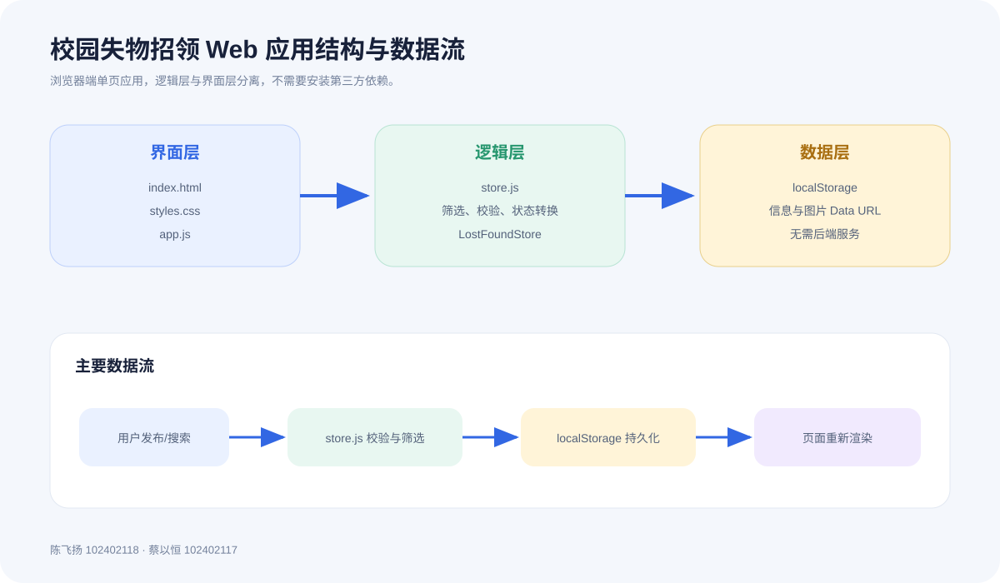
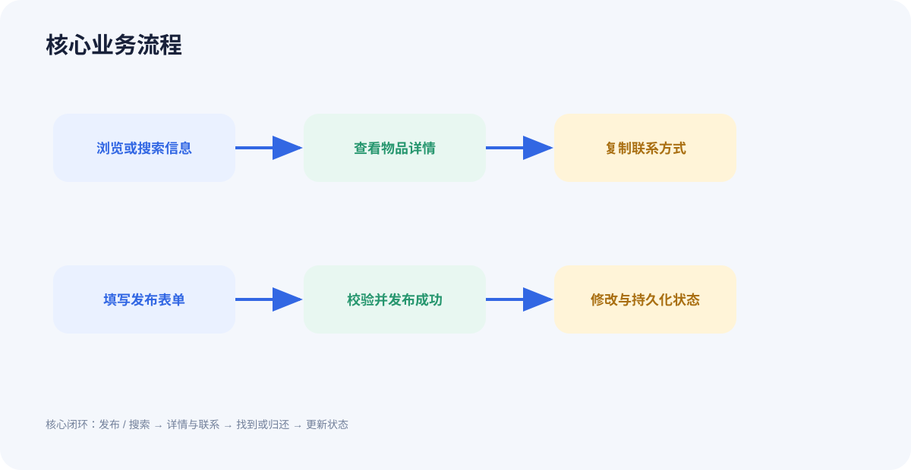

# 校园失物招领 Web 应用

软件工程第二次结对作业之程序实现。项目根据第一次结对作业的原型和需求分析，实现了校园失物招领的核心闭环：

**发布信息 → 浏览或搜索 → 查看详情 → 联系发布者 → 更新状态**

## 小组成员

- 陈飞扬，学号 102402118
- 蔡以恒，学号 102402117

## 功能

- 浏览寻物和招领信息
- 发布寻物信息或招领信息
- 按物品名称、地点和描述搜索
- 按信息类型、物品分类和地点筛选
- 查看物品详情和发布者联系方式
- 一键复制联系方式
- 在“我的发布”中修改信息状态
- 图片本地预览和保存
- 表单校验、空结果提示、响应式布局
- 数据保存在浏览器 localStorage 中，不需要后端服务

## 运行方式

项目不需要安装第三方依赖。

### 方式一：直接打开

使用 Google Chrome 或 Microsoft Edge 双击打开项目根目录的 `index.html`。

### 方式二：本地服务器

如果浏览器限制本地文件的 localStorage，可以在项目根目录运行：

```powershell
python -m http.server 8080
```

然后访问 `http://localhost:8080`。

## 操作说明

1. 首页可以搜索、筛选并点击信息卡片查看详情。
2. 详情页可以复制发布者联系方式。
3. “发布”页面用于填写寻物或招领信息。
4. “我的发布”页面可以修改状态，例如将“寻找中”改为“已找到”，或将“待认领”改为“已归还”。
5. 数据保存在浏览器 localStorage 中；删除浏览器站点数据即可恢复初始示例。

## 项目结构

```text
.
├── index.html
├── package.json
├── src
│   ├── app.js
│   ├── store.js
│   └── styles.css
├── tests
│   └── store.test.js
├── docs
│   ├── architecture.svg
│   ├── user-flow.svg
│   ├── images
│   ├── PSP.md
│   ├── 测试报告.md
│   └── 博客园提交稿.md
└── README.md
```

## 单元测试

测试使用 Node.js 自带的 `node:test`，不需要安装测试框架：

```powershell
node --test tests/store.test.js
```

当前包含 14 个测试，覆盖搜索、筛选、表单校验、状态转换、排序和统计。

## 主要实现

- `store.js` 负责数据校验、搜索筛选、状态规则和排序，不依赖 DOM。
- `app.js` 负责界面渲染、事件处理、图片预览和 localStorage。
- `styles.css` 提供响应式布局和状态型视觉反馈。
- `tests/store.test.js` 对数据逻辑进行白盒测试。





## 提交说明

本仓库名称为 `102402118-102402117`，符合“第一个学号-第二个学号”的命名要求。项目可以通过 GitHub 进行协作，另一名成员可以 Fork 后通过 Pull Request 提交修改。

